# 🚀 DevOps Practice & Hands-On Engineering Labs

[](#jenkins-cicd-pipeline--automation)
[](#modules--projects-overview)
[](#sonatype-nexus-private-docker-registry)
[](#full-stack-document-asset-hub-docker_volume)
[](#full-stack-document-asset-hub-docker_volume)

Comprehensive, production-grade DevOps repository showcasing end-to-end containerization, private artifact and container registries (Sonatype Nexus), Jenkins CI/CD automation pipelines, multi-container Docker architectures, and persistent storage management.

---

## 📑 Table of Contents

- [Overview & Architecture](#-overview--architecture)
- [Repository Structure](#-repository-structure)
- [Modules & Projects Overview](#-modules--projects-overview)
  - [1. Jenkins CI/CD Automation (`jenkins/`)](#1-jenkins-cicd-automation-jenkins)
  - [2. Sonatype Nexus Docker Registry (`docker_pull_push_nexus/`)](#2-sonatype-nexus-docker-registry-docker_pull_push_nexus)
  - [3. Full-Stack Document Asset Hub (`docker_volume/`)](#3-full-stack-document-asset-hub-docker_volume)
  - [4. Dockerized Node.js Microservice (`my-app/`)](#4-dockerized-nodejs-microservice-my-app)
  - [5. Express User Profile Service (`new_project/`)](#5-express-user-profile-service-new_project)
- [Port Allocation Map](#-port-allocation-map)
- [Quick Start Guide](#-quick-start-guide)
- [Jenkins Pipelines in This Repo](#-jenkins-pipelines-in-this-repo)
- [Useful Commands Cheat Sheet](#-useful-commands-cheat-sheet)

---

## 🏛 Overview & Architecture

This repository demonstrates a production-grade DevOps engineering lifecycle:

```mermaid
%%{init: {'theme': 'base', 'themeVariables': { 'primaryColor': '#1e293b', 'primaryTextColor': '#ffffff', 'primaryBorderColor': '#38bdf8', 'lineColor': '#64748b', 'secondaryColor': '#0f172a', 'tertiaryColor': '#1e1b4b' }}}%%
flowchart LR
    Dev(["👨‍💻 Developer<br/><b>Git Commit & Push</b>"]):::devNode
    Repo[("🐙 GitHub<br/><b>devops_practice</b>")]:::gitNode
    Jenkins["⚙️ Jenkins CI/CD<br/><b>Pipeline Automation (:8088)</b>"]:::jenkinsNode

    Dev ==>|git push| Repo
    Repo ==>|Webhook / Poll SCM| Jenkins

    subgraph CI[" 🚀 AUTOMATED CI/CD PIPELINE "]
        direction TB
        C1["📥 Checkout SCM"]
        C2["🔍 Code Quality & Checks"]
        C3["🐳 Docker Build & Tag"]
        C4["📦 Push (Nexus :8083 / Hub)"]
        C5["🚢 Zero-Downtime Deploy"]
        C6["🩺 Health Check Verification"]
        
        C1 --> C2 --> C3 --> C4 --> C5 --> C6
    end

    Jenkins ==>|Executes Stages| CI

    subgraph PROD[" 🌐 PRODUCTION RUNTIME (Docker Bridge: docvol-net) "]
        direction TB
        App["📱 Node.js Application<br/><b>Document Asset Hub (:3002)</b>"]:::appNode
        DB[("🍃 MongoDB Database<br/><b>Data Store (:27017)</b>")]:::dbNode
        Express["📊 Mongo-Express<br/><b>Admin GUI (:8082)</b>"]:::uiNode
        
        App <==>|Internal DNS 'mongodb'| DB
        Express -.->|Management| DB
    end

    subgraph PERSIST[" 💾 PERSISTENT VOLUMES "]
        VolApp[("📁 ./docvol-storage<br/>(Binary Uploads)")]:::volNode
        VolDB[("💽 ./mongo-data<br/>(BSON Data Files)")]:::volNode
    end

    C5 ==>|Deploys to| App
    App --- VolApp
    DB --- VolDB

    classDef devNode fill:#3b82f6,stroke:#1d4ed8,stroke-width:2px,color:#ffffff;
    classDef gitNode fill:#24292e,stroke:#f0f6fc,stroke-width:2px,color:#ffffff;
    classDef jenkinsNode fill:#d97706,stroke:#b45309,stroke-width:2px,color:#ffffff;
    classDef appNode fill:#0284c7,stroke:#0369a1,stroke-width:2px,color:#ffffff;
    classDef dbNode fill:#15803d,stroke:#166534,stroke-width:2px,color:#ffffff;
    classDef uiNode fill:#7c3aed,stroke:#6d28d9,stroke-width:2px,color:#ffffff;
    classDef volNode fill:#475569,stroke:#334155,stroke-width:2px,color:#ffffff;
```



---

## 📂 Repository Structure

```text
devops_practice/
├── jenkins/                      # Jenkins CI/CD Automation & Job Specs
│   ├── Jenkinsfile               # Declarative Pipeline (Build -> Deploy -> Health Check)
│   ├── Jenkinsfile.dockerhub     # Pipeline for automated build & push to Docker Hub
│   ├── Jenkinsfile.nexus         # Pipeline for automated build & push to Sonatype Nexus
│   ├── JENKINS_JOB_TYPES.md      # Deep dive on Freestyle, Pipeline, Multibranch, Matrix jobs
│   ├── README.md                 # Complete Jenkins setup & troubleshooting guide
│   └── docker-compose.yaml       # Compose file to spin up Jenkins LTS with Docker socket
│
├── docker_pull_push_nexus/       # Sonatype Nexus OSS Private Registry Lab
│   ├── README.md                 # Step-by-step setup, Realm activation & push/pull guide
│   └── docker-compose.yaml       # Compose stack for Nexus 3 with persistent volume
│
├── docker_volume/                # Production Document Asset Hub with Mongo & Volumes
│   ├── server.js                 # Express server with file upload & Mongo metadata CRUD
│   ├── Dockerfile                # Multi-stage optimized Node.js Alpine container
│   ├── docker-compose.yaml       # Multi-service stack (App + MongoDB + Mongo-Express)
│   ├── public/                   # Glassmorphic responsive frontend UI
│   ├── docvol-storage/           # Persistent host directory for binary uploads
│   └── mongo-data/               # Persistent database storage
│
├── my-app/                       # Microservice with Docker SOP Guide
│   ├── server.js                 # REST API with health and system endpoints
│   ├── dockerfile                # Container definition
│   ├── mongo-docker-compose.yaml # Database orchestration
│   └── DOCKER_SOP_GUIDE.md       # Standard Operating Procedures for Dockerization
│
└── new_project/                  # Lightweight Express & Mongo User Profile service
    ├── server.js                 # User profile CRUD API
    ├── Dockerfile                # Alpine container definition
    └── docker-compose.yaml       # Compose orchestration
```

---

## 📦 Modules & Projects Overview

### 1. Jenkins CI/CD Automation (`jenkins/`)
- **Containerized Jenkins LTS** configured with Docker-in-Docker via `/var/run/docker.sock`.
- **Declarative Jenkinsfile Pipelines:**
  - Automated Git checkout using SSH/HTTPS credentials.
  - Verification & Code Quality checks.
  - Image building with dynamic tagging (`docvol:${BUILD_NUMBER}`).
  - Zero-downtime deployment creating dedicated bridge networks (`docvol-net`) connecting Node.js and MongoDB.
  - Automated health check verification.
- **Reference Documentation:**
  - [Jenkins Setup & Troubleshooting Guide](jenkins/README.md)
  - [Jenkins Job Types Architecture & Tradeoffs](jenkins/JENKINS_JOB_TYPES.md)

### 2. Sonatype Nexus Docker Registry (`docker_pull_push_nexus/`)
- Local private container registry hosted on Sonatype Nexus OSS 3.
- Includes HTTP connector setup on port `8083`, Docker Bearer Token Realm authentication, insecure-registry daemon configuration, and automated CLI `docker push` / `docker pull` verification.
- **Reference Documentation:**
  - [Nexus Setup & Registry Guide](docker_pull_push_nexus/README.md)

### 3. Full-Stack Document Asset Hub (`docker_volume/`)
- Express.js + MongoDB multi-tier web application.
- Dual storage engine: binary documents saved to disk with persistent Docker host volumes (`./docvol-storage`), while metadata, file hashes, and telemetry are stored in MongoDB.
- Includes Mongo-Express web UI for database administration.

### 4. Dockerized Node.js Microservice (`my-app/`)
- Standalone Node.js service demonstrating standard Dockerization patterns.
- Includes comprehensive Docker SOP documentation covering image optimization, caching strategies, layer minimization, and multi-container debugging.
- **Reference Documentation:**
  - [Docker SOP Guide](my-app/DOCKER_SOP_GUIDE.md)

### 5. Express User Profile Service (`new_project/`)
- Clean user profile and document ingestion REST service with MongoDB persistence and Docker Compose orchestration.

---

## 🌐 Port Allocation Map

| Service Name | Container Internal Port | Host Mapped Port | Description |
|---|---|---|---|
| **Jenkins Web UI** | `8080` | **`8088`** | Jenkins automation server web interface |
| **Jenkins JNLP Agent** | `50000` | **`50000`** | Inbound build agent communication port |
| **Nexus OSS Web Console** | `8081` | **`8081`** | Sonatype Nexus repository manager UI |
| **Nexus Private Docker Registry** | `8083` | **`8083`** | Docker V2 hosted registry connector |
| **Document Asset Hub (App)** | `3000` | **`3002`** | Node.js Document Hub web application |
| **MongoDB** | `27017` | **`27017`** | Primary MongoDB database service |
| **Mongo-Express** | `8081` | **`8082`** | Database Web UI Management portal |

---

## ⚡ Quick Start Guide

### Prerequisites
- Docker Engine `>= 24.0.0`
- Docker Compose `>= v2.20`
- Git

### 1. Clone the repository
```bash
git clone https://github.com/Navneet120604/devops_practice.git
cd devops_practice
```

### 2. Run Document Hub Stack locally
```bash
cd docker_volume
docker compose up -d
# Access web application at http://localhost:3002
# Access Mongo-Express at http://localhost:8082
```

### 3. Launch Jenkins CI/CD Engine
```bash
cd ../jenkins
docker compose up -d
# Access Jenkins at http://localhost:8088
```

---

## 🤖 Jenkins Pipelines in This Repo

| Pipeline File | Purpose | Stages Included |
|---|---|---|
| [`jenkins/Jenkinsfile`](jenkins/Jenkinsfile) | **End-to-End Build & Self-Contained Deployment** | Checkout ➔ File Validation ➔ Docker Build ➔ Network & DB Setup ➔ Deploy ➔ Health Check |
| [`jenkins/Jenkinsfile.dockerhub`](jenkins/Jenkinsfile.dockerhub) | **Automated Build & Push to Docker Hub** | Checkout ➔ Quality Check ➔ Docker Build ➔ Registry Login ➔ Push to Docker Hub |
| [`jenkins/Jenkinsfile.nexus`](jenkins/Jenkinsfile.nexus) | **Automated Build & Push to Nexus Private Registry** | Checkout ➔ Quality Check ➔ Docker Build ➔ Authenticate ➔ Push to Nexus :8083 |

---

## 🛠 Useful Commands Cheat Sheet

### Docker & Container Operations
```bash
# View all running project containers
docker ps --format "table {{.Names}}\t{{.Status}}\t{{.Ports}}"

# Inspect shared application network
docker network inspect docvol-net

# View logs of the deployed application
docker logs -f docvol-app-prod
```

### Jenkins Management
```bash
# Get initial Jenkins admin password from container
docker exec -it jenkins cat /var/jenkins_home/secrets/initialAdminPassword

# Verify Docker daemon access from inside Jenkins
docker exec -it jenkins docker info
```

---

## 📄 License
This repository is licensed under the [MIT License](LICENSE).